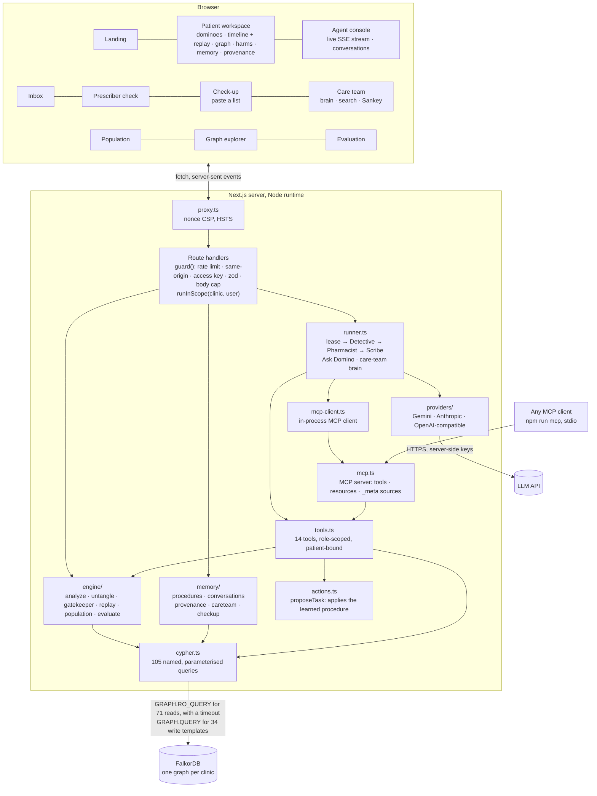

# Architecture

Domino is one Next.js 16 application backed by FalkorDB. There is no second database, no vector store and no cache that
could answer a question without the graph. Every finding, path, alternative, memory, handoff, lease, learned procedure,
conversation and search is a FalkorDB query.



## Tenants and the session

Each clinic is its own FalkorDB graph: `domino` (Riverside, 606 patients) and `domino_lakeview` (Lakeview, 300 patients), each seeded with
its own cohort, prescribers, outcome history and learned procedures. `src/lib/tenant.ts` defines the clinics and the demo people.

- Every route handler runs inside `runInScope()`, an `AsyncLocalStorage` scope built from the `domino_clinic` and `domino_user` cookies.
  Both are checked against allowlists; an unknown value falls back to the default clinic and its first person.
- Server components read the same cookies through `next/headers`. Scripts, tests and the MCP server set the scope explicitly
  (`DOMINO_CLINIC` for the MCP server).
- `getGraph()` picks the graph from the scope. No request parameter, query argument or model tool call can name a graph.
- The person in the scope signs decisions, decides tasks and owns conversations. The demo people are not authentication; in production
  they map to an SSO identity ([SECURITY.md](SECURITY.md)).

## Request flow for a review

1. The browser POSTs `/api/patients/{id}/review`. `guard()` applies the `agent` rate-limit bucket (8 burst, 6 per minute), checks
   `Sec-Fetch-Site` and `Origin`, checks the optional access key, and validates the body with zod.
2. The route returns a `text/event-stream` and calls `runReview()`, which first takes the lease `review:<patient>` in the graph
   (`src/lib/lock.ts`). If another instance holds it, the route answers 409 before any stream (or, in a race, the stream carries one error
   event) and nothing runs; the page says someone else is running this patient's review and starts its own when theirs ends. The lease is
   renewed every 30 seconds and released by its owner.
3. `runReview()` creates a `Run` node linked to the previous run for the patient (`FOLLOWS`), then runs the three agents. Each tool call becomes
   one `Step` node with the catalog `Query` nodes it `RAN`; each event is streamed to the browser in the same order.
4. Each agent is either an LLM tool-calling loop (max 8 turns, 4 calls per turn, 45 s per request) or the deterministic planner. Both call the
   same `callTool()`, which checks the agent's role, validates arguments with zod and turns errors into safe messages.
5. The Detective starts by comparing this run's findings with the previous run's (`previousRunFindings`), so the run says what changed.
   Findings record what the run changed (`recordChanges`).
6. Between agents, the handoff passes the wording guard (one that instructs a medication change is held back and replaced by a neutral
   line), is signed with HMAC-SHA256, written as a `Handoff` node linked to the findings it `CARRIED`, read back by the next agent and verified.
   A failed verification stops the run.
7. The Scribe's tasks go through `proposeTask()`, which reads the active `Procedure` for the pattern, routes the task, skips "possible" links if
   the procedure says so, halves the due date when a drug in the cascade is a betweenness chokepoint, addresses it to the prescriber of the
   root drug, and links it to the procedure (`FOLLOWED`).
8. When the run ends, each step is linked to what it wrote (`PRODUCED`), and the summary is written to the `Run` and the `Patient`.

## Why the planner exists

Judges, reviewers and clinicians should be able to run Domino without an API key, and an agent that depends on a model being up
fails in exactly the moment it is needed. The planner is not a mock: it calls the same tools in the same order a good model does,
decides from what the graph returns (which links to record, which roots to examine, which tasks to propose), stores the same audit
trail, and produces the same artefacts. With a key, each agent becomes an LLM loop with two safety nets: if the Detective records
nothing or the Scribe proposes nothing, the planner's step runs and the trace says so; and if the model itself fails (every Gemini
model over quota, an outage, a timeout), the planner finishes that step and the rest of the run with the same tools (each finding and
note kind is recorded once, whoever records it), the console shows a warning, the run records what actually did the work, and the model
is skipped for a minute (`/api/health` shows why), so a busy demo on a free key degrades instead of breaking. Time is bounded: one
deadline per model call across all fallbacks (`LLM_TIMEOUT_MS`, 45 s), and a budget per agent (80 s in a review, 70 s for a question),
inside the routes' limits. Cancelling (closing the stream) stops the call and never runs the tools the model asked for after it.

**Gemini** (`src/lib/agent/providers/index.ts`): `gemini-3.8-flash` by default, falling back to `gemini-3.6-flash`,
`gemini-3.5-flash-lite` and `gemini-2.5-flash` on 403/404/408/429/5xx (a model over quota or not open to the key is skipped for a
while). Gemini 3 models get `thinkingConfig.thinkingLevel: "low"` (fast tool turns; `GEMINI_THINKING` raises it) and no sampling
parameters, which they ignore; 2.x models get a temperature. Function-call turns are replayed verbatim with their thought signatures.
Tool schemas are sent as OpenAPI-style declarations. Tests run all of it against a local stand-in that follows the documented REST
shapes (`tests/gemini.test.ts`, `tests/providers.test.ts`).

## Engine

`analyzePatient()` loads the patient, then runs nine queries in parallel (links, paths, loops, other reasons, pile-ups, harm paths,
combinations, burden, memory), then scores each link. The medical knowledge it scores with (documented patterns with their evidence and
questions, dangerous-combination rules, drug cards with class, burden, Beers note and taper caution) is read from the graph by
`src/lib/engine/knowledge.ts` (three catalog queries, kept a few minutes per process and forgotten on reseed). The prescriber check, the
untangle and the CDS service use the same graph-read rules for lists the graph does not hold yet (a new prescription, a what-if, an EHR's
orders), so there is one source of medical knowledge, and it is the one a reviewer can query.

**An algorithm sets priority.** Every review runs FalkorDB's betweenness centrality over the cascade subgraph (`find_chokepoints`). A review
task for a cascade that includes one of the top drug chokepoints is due in half the usual time, and its text says which drug and its score.

**Names are resolved, never guessed.** `resolve_drug` matches a name against the full-text index (generic, brand, alias, typos) and either
says the patient takes it, runs the prescriber check for a drug they do not take, or says it is not in the graph and was not checked. The
planner answers that way on its own; the model's prompt requires it. A question that names an unknown medicine alongside known ones gets the
unknown one named at the top of the answer.

Scoring:

```
score = weight(frequency) × timing × indication × history × evidence × memory
```

| Factor | Values | Source in the graph |
| - | - | - |
| weight | 0.9 very common, 0.7 common, 0.4 uncommon, 0.2 rare | `CAUSES.weight` |
| timing | 0 if B started first (excluded), 0.3 same day, 1.0 inside the onset window, 0.55 too early, 0.6 up to twice the window, 0.35 later | `TAKES.start`, `CAUSES.onsetMin/Max` |
| indication | 1.25 B charted for the effect, 0.3 charted for another diagnosis on record, 0.5 another reason possible, 1.0 none | `TAKES.indication`, `HAS`, `TREATED_BY` |
| history | 0.25 if the effect was diagnosed before A started | `HAS.since` |
| evidence | 1.2 consensus, 1.15 study, 1.0 labelling, 0.85 graph-inferred | `Pattern` via `INDEX`, `VIA`, `MARKER` |
| memory | 1.3 confirmed (and never below possible, even for a "usually deliberate" pattern); intentional or not-a-cascade re-tier the link | signed `Decision` |

Tiers: likely ≥ 0.5, possible ≥ 0.25. Patterns marked as usually deliberate (gastroprotection, potassium with diuretics, B12 with
metformin, laxatives with opioids) are tiered **intentional** and never counted as cascades, unless a clinician confirms one.

Chains come from the variable-length path query, which starts only at the patient's own medicines and stays inside their medicine list.
Each hop uses the strongest link for that drug pair, the walk stops at the first link that is not likely, possible or intentional, and
leading intentional links are trimmed, so every chain starts at a real cascade link. A chain is dropped only when a longer chain from the
same root contains it. Trees group chains by root: a drug with an active outgoing link and no likely link into it. A root whose first links
are only "possible" and feed a stronger tree is shown as a **contributor** to that tree instead of a tree of its own.

A drug has an **independent reason** when a diagnosis it treats is on record and is either not a side effect of another of the
patient's drugs, or was diagnosed before the drug that could have caused it.

The **untangle** is a fixed-point computation: a medicine stays justified if it has its own diagnosis, has no cascade link into it,
or is reached by a strong link from a justified medicine. Everything else "might not be needed" if the root were reviewed.
Possible links from elsewhere are reported as "also contributing", never hidden. Medicines that must not be stopped abruptly
(beta blockers, benzodiazepines, antidepressants, opioids, steroids, and 10 more classes) carry a taper warning, in the what-if and
in the SBAR note.

## Prescriber check

`checkPrescription()` asks the graph what a new drug would do to this patient *before* it is written, and scores each "this treats a side
effect of something they take" link with the **same `scoreLink()` the review uses**, as if the drug were written today.

| Verdict | When |
| - | - |
| **Stop and check** | a documented, non-deliberate cascade pattern that scores *likely*, or *possible* when the effect is not charted as a diagnosis; a graph-inferred link that scores *likely*; a dangerous combination completed; a class conflict |
| **Caution** | any other *possible* link (a documented one whose effect is also charted as a diagnosis is ambiguous on paper); the anticholinergic burden crossing 3; a Beers criteria drug |
| **Clear** | none of the above; *unlikely* links are listed with their factors but raise nothing |

A deliberate companion link (a PPI with an NSAID, potassium with a loop diuretic) is shown as planned care and never raises a stop by itself; the same drug can still be stopped if it also treats a likely side effect of something else on the list. An indication
the prescriber gives ("for hypertension") is scored like a charted one.

## Counterfactual replay

`src/lib/engine/replay.ts` replays a patient's record one prescription at a time, running the prescriber check with `asOf` set to the day
each drug was written (only earlier prescriptions and diagnoses count). The first documented-cascade stop is a **catch**; everything the
caught drug led to is what might never have been written. Later prescriptions are re-checked with the avoided drugs excluded, so one catch
never produces a second, phantom one. The workspace timeline animates it (*Play the replay*).

For the cohort, the same replay runs against the generator's ground truth: how many true cascades the check would have caught at the
first downstream prescription, how many prescriptions that would have saved, the positive predictive value of a stop, and the alert burden
([EVALUATION.md](EVALUATION.md)).

## Memory, provenance and the care-team brain

- **Procedural memory** (`src/lib/memory/procedures.ts`): after every task decision, the procedure for that task's pattern is re-learned
  from the decided tasks, and a change writes a new version ([AGENTS_AND_MEMORY.md](AGENTS_AND_MEMORY.md)).
- **Conversations** (`src/lib/memory/conversations.ts`): Ask Domino and the care-team brain store every question and answer per person,
  with the queries behind each answer, and send up to eight earlier messages with the next question.
- **Provenance** (`src/lib/provenance.ts`): one query, `trace_finding`, returns the run, the step that wrote a finding, every step and
  query of that run, the drugs, effect, pattern and references, the decisions it considered, the handoffs that carried it and the tasks it
  led to. The workspace draws it as a graph.
- **Semantic memory** (`src/lib/embeddings.ts`, `src/lib/semantic.ts`): with a Gemini key, team notes, tasks, drafted notes, signed
  decisions and conversation messages are embedded with `gemini-embedding-2` (768 dimensions, retrieval prefixes) and the vector is
  stored on the node itself, which gets the `Memory` label; one FalkorDB vector index (HNSW, cosine) covers them all. Each vector records
  the model that made it (`gemini-embedding-001` is the fallback for keys that cannot use the newer one), and only vectors from the same
  model are compared. Embedding is lazy and bounded: before a search, up to 64 items without a vector are embedded, newest first, so a note
  written a moment ago is findable by meaning on the next question; `npm run embed` (and `npm run setup`) backfills everything.
- **Care-team brain** (`src/lib/careteam.ts`): one search across tasks, notes, team notes, decisions, findings and conversation messages,
  fusing three signals by reciprocal rank: words (the full-text index, typos included), meaning (the vector index, `search_meaning`) and
  the graph (the question is linked to patients, drugs and symptoms, and memories connected to them rank higher). Each hit says how it
  matched. Without a key, or if the embedding model is over quota, it is words and the graph, and the page says so. Also: who owns
  what (prescribers); who knows what (who acted on or decided each kind of cascade); where cascades cross from one prescriber to another;
  and the learned procedures. The brain agent reaches all of it through MCP.
- **Notes the agents act on** (`src/lib/noticed.ts`): saving a team note links it (`MENTIONS`). If it names exactly one patient (a name
  two patients share counts as two, so the note is not acted on) and reports a symptom rather than ruling it out ("no cough", "denies
  dizziness", "swelling resolved" do not count), it runs `note_culprits`: the patient's own drugs that `CAUSES` that symptom, whether one
  of their drugs is already `TREATED_BY` it, and the documented pattern. A treater started after the culprit is a cascade in progress, and
  only raised if the review engine rates that exact pair likely or possible; no treater at all is a prevention window; a treater started
  before the culprit (or with no start date) is neither, and nothing is raised. The strongest signal goes through `proposeTask` like
  every other task (procedural memory, dedupe, wording guard, HMAC signature). A task the note raised links back with `FROM_NOTE`; if the
  same question was already open, the note `CORROBORATES` that task instead of claiming it, so the inbox, the notes list and the
  provenance graph show who actually raised each task and which notes back it up.
- **Follow-ups** (`src/lib/followup.ts`): marking a verified review task done re-runs the analysis for that patient and looks up the
  task's own link. Only if the engine still rates it likely or possible (and no clinician has signed it as intentional or not a cascade)
  does it propose a follow-up due in 28 days: has the symptom settled, and could the medicines after that link on its chains, which the
  untangle finds unnecessary, be reviewed (with their taper warnings, passed through the wording guard). It goes through `proposeTask` and is
  linked with `FOLLOWS_UP`, so the chain of what was done and what comes next is a path in the graph.
- **Live team activity** (`Q.activity`, `/api/activity`, `src/components/ActivityBell.tsx`): one read query unions what changed since a
  timestamp (tasks proposed, decided and completed, notes, signed verdicts, re-learned procedures, finished runs). Every open screen polls
  it every five seconds while visible, so the graph is the shared state: a decision in one browser updates the inbox, the notes and the
  bell in every other, with a toast for what other people did. Every event carries the id of its node; each poll re-reads the last 30
  seconds and drops what it has already seen, so two events in the same millisecond, or one committed just after a poll, are never missed.

## FHIR export

`GET /api/patients/:id/fhir` (the *Export FHIR* button) turns the same analysis into a FHIR R4 `Bundle` of type `collection`:
`Patient`, `Condition`, one `MedicationStatement` per medicine, one `DetectedIssue` per likely or possible cascade link (severity from
the tier, both medicines `implicated`, the effect and documented pattern as `evidence`, the score and factors in `detail`, the reference
URL) and per dangerous combination, one `Task` per open review task (`intent: proposal`, `focus` on its issue), and a `Provenance` for
the issues. Codes are Domino's own CodeSystems under the deployment URL, always with display text, because the knowledge graph has no
RxNorm or SNOMED mapping yet; resources are tagged `HTEST` (synthetic). Every id is mapped to a valid FHIR id (`[A-Za-z0-9-.]{1,64}`, long ids shortened with a hash so they stay unique), the same way in references; tests check every id is valid and every reference resolves inside the bundle.

## CDS Hooks

Domino is a CDS Hooks 2.0 service (`src/lib/cds.ts`, `src/app/cds-services/**`). `GET /cds-services` lists two services,
`domino-order-select` and `domino-order-sign`, with prefetch templates for the patient, active `MedicationRequest`s and active
`Condition`s. A call is validated with zod (unknown fields pass through; everything read is bounded), and then:

1. The draft `MedicationRequest`s (only the selected ones for order-select) are matched to `Drug` nodes by name through the full-text
   index (`find_drugs`). A candidate is accepted only if its generic name appears whole in the coding display or text (or, for a
   combination drug like carbidopa-levodopa, one ingredient per `/` component), or else a brand or alias does; a salt word (calcium,
   potassium, sodium…) counts only when it leads the name, so "atorvastatin calcium" is atorvastatin. Combination products
   ("lisinopril / hydrochlorothiazide") give every ingredient. There is no RxNorm mapping yet, and a guess is worse than no match: an
   order that matches nothing is not checked, and says so with an `info` card ("Domino did not check Zzqx: it is not a medicine in
   Domino's graph"), because silence would read as a clean check and not being in the graph is not the same as safe. Each drug is
   checked once per call.
2. The patient: a Domino id in this clinic's graph uses the stored record. Anyone else needs the `medications` prefetch (without it the
   service answers 412, as the spec says) and is built from it: active, on-hold or intended medicines with their `authoredOn` dates (any
   year, moved into Domino's synthetic calendar so "started 20 days ago" stays true; a missing date is placed in list order and the card
   says so) and conditions matched through `find_effects`, as a temporary
   check-up patient, the same capped, expiring sandbox as `/checkup`, named "EHR order check". It is found again by a hash of the EHR's
   patient id and the lists (`find_ehr_sandbox`), so order-select then order-sign builds one; the EHR's own id and name are never stored.
3. Each order runs `checkPrescription` (the prescriber check). A verdict other than clear becomes a card: `warning` for a cascade stop,
   `critical` when it completes a dangerous combination, `info` for a caution; a summary under 140 characters, the engine's headline and
   the pattern's question as markdown detail, a `delete` suggestion for the draft order (`resourceId: "MedicationRequest/<id>"`), override
   reasons (`intentional`, `not-a-cascade`, `will-review`) that mirror Domino's signed decisions, and a link back to the patient. A
   dangerous combination that no single drug completes gets its own `critical` card when a combination product completes it
   ("lisinopril / HCTZ" with an NSAID on file) or several orders complete it together, with a suggestion to hold each order; renewals of
   medicines already on file never count as new.
4. At order-sign the cards are written as `CdsCard` nodes (`record_cds_cards`); a retried call (same `hookInstance`) gets the same card
   ids back, matched card for card by slot (the drug, or the combination) (`cds_cards_for_call`), and stores nothing twice. `trim_cds_cards` never deletes an answered card, and keeps the newest 50
   unanswered per patient and 2,000 overall. Feedback (`POST /cds-services/{id}/feedback`) sets the outcome on a card Domino issued, to
   the same caller, first answer only, even within one request (`cds_feedback`); the reason the team sees is Domino's wording for the
   code, never the caller's text. Both appear in the team's live activity feed (named by check, not by card id), and `/ehr` shows the
   totals (`cds_recent`).

Trust (`src/lib/cdsAuth.ts`): with `DOMINO_CDS_ISSUERS` set (issuer → JWKS URL or key set), every call needs the EHR's bearer token as
CDS Hooks specifies: a trusted `iss`, a key from its JWKS (fetched and cached for ten minutes), an ES384/RS384 signature, `aud` equal to
the service URL, a lifetime of five minutes at most, and a `jti` not seen before. A verified EHR may write (cards, a temporary patient) and
is named by its issuer's host in the activity feed. Without the variable the service is an open demo.

These routes answer with CORS headers (and only these). Cross-origin calls carry no cookies, so they run in the default clinic; calls from
Domino's own `/ehr` page run in the clinic the person chose. `/ehr` is a deliberately plain, fictional EHR that sends the real requests
and shows them, with Domino's answers, on screen.

## Check-up

`/checkup` lets someone paste a medication list in plain words ("Norvasc 10 mg since March 2025, water pill, Ditropan"). Each line is
matched to a `Drug` node through FalkorDB's full-text index over generic names, brand names and plain terms, with fuzzy matching for typos.
User text is reduced to lower-case words of three letters or more, so no search operator reaches the index. The list becomes a temporary
**sandbox** patient (`p-ck-…`) in the clinic's graph; the same engine and agents review it. Sandbox patients expire after two hours, are capped
at 200, are purged when a new one is created, and never appear in patient lists, the population, the inbox or search.

## MCP

`src/lib/mcp.ts` is a real MCP server (the official SDK). It serves the patient read tools, the care-team tools, the query catalog and the
graph model as resources. Inside the app, Ask Domino and the care-team brain connect to it with an in-memory transport and call every tool
with `tools/call`; with a language model they also discover the tools with `tools/list` and the model chooses them (the planner chooses by
rules). Every result carries `_meta["domino/queries"]`, the catalog query ids it ran, which
become the answer's cited sources. `npm run mcp` serves the same thing over stdio to any MCP client, for one clinic per process.

## Front end

Server components load data directly from the engine (no client-side secrets). Interactive parts are client components that talk to
the API. Animations use Motion and respect `prefers-reduced-motion`. Charts and graphs are hand-drawn SVG (d3-force for layout only),
so they inherit the design tokens and need no third-party scripts, which keeps the CSP strict.

Two scenes are real 3D, in plain three.js (bundled; the CSP adds only `worker-src 'self' blob:` for the GPU check):

- **The landing hero** (`src/components/three/DominoScene.tsx`): Beatrice's four medicines as lacquered tiles with soft shadows and a
  room-lit environment. The fall is a small physics step (gravity, contact angle, a lean on the next tile) at a fixed 120 Hz, so it keeps
  real time on slow devices. The camera widens its lens, then steps back, to keep the whole chain in frame at any aspect ratio.
- **The knowledge graph** (`src/components/three/KnowledgeGraph3D.tsx`, on `/graph`): every `Drug` and `Effect` and every `CAUSES` and
  `TREATED_BY` edge, read with `Q.knowledgeNodes` and `Q.knowledgeEdges`, laid out with a small 3D force simulation. Picking a patient's
  cascade draws it as a lit path through the whole graph; hovering (or tapping) a node shows what it touches.

Both are loaded with `next/dynamic` after the page is interactive (three.js is not in any other page's bundle), render only while on screen
and while the tab is visible, show a still frame under `prefers-reduced-motion` (for the hero, the end of the story: every tile down, every side effect labelled), and fall back when they can't run: the hero keeps its lightweight version (the HTML tiles it is server-rendered with) on a software renderer or without WebGL 2, and the graph says so and points to the 2D explorer below it. Neither creates a WebGL context during page load: GPU detection asks WebGPU's asynchronous adapter query where available, otherwise reads the renderer's name from a WebGL context in a tiny Web Worker (an OffscreenCanvas, so the main thread never waits for a GPU to start), and only as a last resort probes on the main thread when the browser is idle. The hero then builds when the page is idle and compiles its shaders asynchronously before its first frame; on a software renderer the 3D graph holds still and draws only when touched. On this container (no GPU), that took the landing page's Lighthouse total blocking time from about 7 s to 0.15 s on desktop.
On touch screens one finger scrolls the page and two fingers orbit, so the graph never traps the scroll.

## Performance

`npm run bench` measures a running database: parallel analyses (about 100 per second, about 1,000 graph queries per second, on a
laptop-class container), parallel agent runs with every step written to the graph, the lease under contention, and clinic isolation
([BENCHMARK.md](BENCHMARK.md)).

## Running as a public demo

`src/lib/demo.ts`. With `DOMINO_OPEN_DEMO=true`, the writes a visitor needs to try the product (marked `write: 'demo'` in their routes) need
no access key; they are still same-origin and rate-limited, a visitor's team note may not contain links, the six story patients' medicine
lists stay as they are, and the key still guards sweeps and the reset. The evaluation re-run is open but holds a lease, so one runs at a time. With `DOMINO_DEMO_RESET=nightly`, the nightly cron (`/api/cron/sweep`, 21:30 UTC) rebuilds every clinic from the seed
(seed, sweep, embeddings) instead of only sweeping. `/api/cron/keepalive` (called every three hours by `.github/workflows/keepalive.yml`)
queries each clinic's graph, which keeps an idle hosted instance in use, and reseeds any graph that came back empty: FalkorDB Cloud's free
tier stops an instance after a day unused and keeps no data across a restart. Both cron routes need `CRON_SECRET`.
